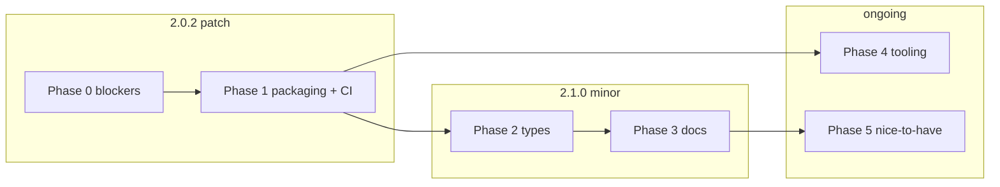

# react-moment Fix Plan

Prioritized remediation derived from [REVIEW.md](./REVIEW.md). Ordered by **impact × urgency**; items within a phase can often be parallelized.

**Legend:** Effort = S (hours), M (half-day), L (multi-day)

---

## Phase 0 — Blockers (ship before next release)

These are confirmed bugs affecting correctness in production.

| # | Fix | Files | Effort |
|---|-----|-------|--------|
| 0.1 | **Fix pooled timer interval change** — Remove `entriesRef.current.clear()` from effect cleanup, or re-create `PoolController` when `interval` changes so child effects re-register. Prefer: only `clearInterval` in cleanup; let entry add/remove lifecycle manage the Set. | [`src/MomentContext.tsx`](src/MomentContext.tsx) | S |
| 0.2 | **Unify datetime pipeline for DOM attrs** — Extract `getAdjustedDatetime(props, settings)` that applies parse + tz + add/subtract once. Use it for `dateTime`, `getTitle`, `getContent`, and `useMomentContent.datetime`. | [`src/utils.ts`](src/utils.ts), [`src/Moment.tsx`](src/Moment.tsx), [`src/hooks/useMomentContent.ts`](src/hooks/useMomentContent.ts), [`src/renderers/getContent.ts`](src/renderers/getContent.ts) | M |
| 0.3 | **Emit valid ISO `dateTime`** — Replace raw moment object with `datetime.toISOString()` (or `.format()` when invalid) on the `<time>` element. | [`src/Moment.tsx`](src/Moment.tsx) | S |

**Tests to add in Phase 0:**
- Pooled provider: render → advance timers → change `interval` prop → advance again → assert content updates.
- SSR: `add`/`subtract` → assert `dateTime` matches adjusted date as ISO string.
- `useMomentContent`: assert `datetime` matches adjusted moment used for `content`.

---

## Phase 1 — Major correctness & packaging (next patch)

| # | Fix | Files | Effort |
|---|-----|-------|--------|
| 1.1 | **Fix `getTitle` to respect `props.format`** — Fallback chain: `titleFormat → props.format → settings.format → default ISO`. | [`src/utils.ts`](src/utils.ts) | S |
| 1.2 | **Fix `element={null}` inheritance** — Resolve element as `props.element ?? settings.element ?? 'time'` (nullish coalescing, not `\|\|`). Align types: remove `\| null` from instance prop or document that null is invalid. | [`src/Moment.tsx`](src/Moment.tsx), [`src/types.ts`](src/types.ts) | S |
| 1.3 | **Add `children` to `momentPropKeys`** | [`src/types.ts`](src/types.ts) | S |
| 1.4 | **Trim npm publish surface** — Add `"files": ["dist", "README.md", "LICENSE", "MIGRATION.md"]` (and optionally `CHANGELOG.md`). Expand `.npmignore` to exclude `src/`, `coverage/`, `scripts/`, tests, config. | [`package.json`](package.json), [`.npmignore`](.npmignore) | S |
| 1.5 | **Fix `sideEffects` metadata** — Set `"sideEffects": ["dist/index.mjs", "dist/index.cjs.js", "dist/index.umd.js"]` or `"sideEffects": true` until duration formatting is a peer dep. | [`package.json`](package.json) | S |
| 1.6 | **Add CI test workflow** — GitHub Action on push/PR: `npm ci --legacy-peer-deps`, `npm test`, `npm run build`. Optionally `tsc --noEmit`. | [`.github/workflows/ci.yml`](.github/workflows/ci.yml) (new) | S |
| 1.7 | **Migrate `index.test.tsx` to `createRoot`** — Match [`MomentContext.test.tsx`](src/MomentContext.test.tsx) pattern; required for React 19 peer compatibility. | [`src/index.test.tsx`](src/index.test.tsx) | S |

---

## Phase 2 — Type safety & API polish

| # | Fix | Files | Effort |
|---|-----|-------|--------|
| 2.1 | **Remove index signature from `RenderProps`** — Split into `MomentProps` (known props) + `MomentHTMLAttributes` intersection for passthrough DOM props, or use a generic `Omit<React.ComponentProps<'time'>, keyof MomentSpecificProps>`. | [`src/types.ts`](src/types.ts) | M |
| 2.2 | **Tighten `momentPropKeys`** — Type as `const` array and derive union; include `children`. | [`src/types.ts`](src/types.ts) | S |
| 2.3 | **Align export surface with `.d.ts`** — Either export `getMomentRef` + `objectKeyFilter` from [`src/index.ts`](src/index.ts), or stop emitting [`dist/objects.d.ts`](dist/objects.d.ts) / trim [`dist/utils.d.ts`](dist/utils.d.ts) to only public helpers. | [`src/index.ts`](src/index.ts), [`tsconfig.json`](tsconfig.json) | S |
| 2.4 | **Use settings moment ref in `fromNowDuring`** — Replace `momentLib()` with `getMomentRef(settings)()` in [`getContent.ts`](src/renderers/getContent.ts). | [`src/renderers/getContent.ts`](src/renderers/getContent.ts) | S |
| 2.5 | **Optional peer deps** — Document `moment-timezone` as optional peer; consider `@types` or runtime check with clear error when `tz` is used without it. | [`package.json`](package.json), [`src/utils.ts`](src/utils.ts) | M |

---

## Phase 3 — Documentation sync

| # | Fix | Files | Effort |
|---|-----|-------|--------|
| 3.1 | **README: React 18+ requirement** — Replace "16.8+" with peerDep reality. | [`README.md`](README.md) | S |
| 3.2 | **README: remove stale beta warning** — Update 2.0 section for stable 2.0.x. | [`README.md`](README.md) | S |
| 3.3 | **MIGRATION: fix entry point paths** — `dist/index.cjs.js` / `dist/index.mjs` instead of `dist/index.js`. | [`MIGRATION.md`](MIGRATION.md) | S |
| 3.4 | **README: add Hooks & utilities section** — Document `useMomentContent`, `useMomentContext`, `getContent`, `getDatetime`, `getShortRelativeTime`. | [`README.md`](README.md) | M |
| 3.5 | **Fix `withTitle` examples** — Match actual title fallback behavior after 1.1 fix. | [`README.md`](README.md) | S |
| 3.6 | **Remove or restore SSR example** — Either add minimal `examples/ssr/render.js` or remove SSR claims from MIGRATION. | [`examples/ssr/`](examples/ssr/), [`MIGRATION.md`](MIGRATION.md) | S |
| 3.7 | **Fix README anchor / fromNowShort `ago` claim** | [`README.md`](README.md) | S |
| 3.8 | **Fix objects.ts JSDoc** | [`src/objects.ts`](src/objects.ts) | S |

---

## Phase 4 — Tooling & dependencies

| # | Fix | Files | Effort |
|---|-----|-------|--------|
| 4.1 | **Repair ESLint** — Either migrate to flat `eslint.config.js` + drop Airbnb for `@eslint/js` + `typescript-eslint` v8+, or pin ESLint to 8.x with compatible Airbnb. | [`.eslintrc`](.eslintrc) → `eslint.config.js`, [`package.json`](package.json) | M |
| 4.2 | **Upgrade `@typescript-eslint/*` to v8** — Align with TypeScript 5.9. | [`package.json`](package.json) | S |
| 4.3 | **Remove or replace `coveralls`** — Eliminates `request` audit chain; use GitHub Actions coverage artifact or Codecov OIDC. | [`package.json`](package.json) | S |
| 4.4 | **Release workflow: Node 20 LTS** — Replace Node 16; drop `--legacy-peer-deps` once peers resolved. | [`.github/workflows/release.yml`](.github/workflows/release.yml) | S |
| 4.5 | **Add `engines` field** — e.g. `"node": ">=18"`. | [`package.json`](package.json) | S |
| 4.6 | **Add Jest coverage thresholds** — e.g. 90% branches on `src/renderers/**` and `src/utils.ts`. | [`package.json`](package.json) | S |

---

## Phase 5 — Nice-to-have / architectural

| # | Fix | Files | Effort |
|---|-----|-------|--------|
| 5.1 | **UMD globals** — Use `React` / `moment` standard names in wrapper instead of lowercase. | [`scripts/build.js`](scripts/build.js) | S |
| 5.2 | **Preserve license comments** — `legalComments: 'inline'` or append NOTICE file. | [`scripts/build.js`](scripts/build.js) | S |
| 5.3 | **Invalid date UX** — Dev-only `console.warn` when `!datetime.isValid()`; optional `fallback` prop. | [`src/Moment.tsx`](src/Moment.tsx) | M |
| 5.4 | **Document renderer throw contract** — JSDoc on `ContentRenderer` / `Filter` types. | [`src/types.ts`](src/types.ts), [`src/renderers/types.ts`](src/renderers/types.ts) | S |
| 5.5 | **Externalize or peer `moment-duration-format`** — Reduces bundle size; declare optional peer. | [`scripts/build.js`](scripts/build.js), [`package.json`](package.json) | L |
| 5.6 | **Expand `getShortRelativeTime` tests** — Cover week threshold, sub-minute edge cases; align output with README unit table. | [`src/utils.test.ts`](src/utils.test.ts) | S |
| 5.7 | **Storybook trim control** — `control: 'text'` or union control for `boolean \| string`. | [`stories/Moment.stories.tsx`](stories/Moment.stories.tsx) | S |

---

## Suggested release sequencing

1. **2.0.2** — Phase 0 + Phase 1 (bug fixes, npm tarball slimming, CI, React 19-safe tests).
2. **2.1.0** — Phase 2 + Phase 3 (type-safety breaking improvements for TS consumers, docs overhaul).
3. **Chore releases** — Phase 4 tooling as needed; Phase 5 when bandwidth allows.

---

## Verification checklist (post-fix)

- [ ] `npm test` — 0 failures, no `ReactDOM.render` warnings
- [ ] `npm run build` — dist outputs unchanged API
- [ ] `npm pack --dry-run` — ≤ 15 files, no `src/` or `coverage/`
- [ ] SSR script: adjusted dates, ISO `dateTime`, valid titles
- [ ] Pooled interval change test passes
- [ ] `npm run lint` passes
- [ ] CI green on PR

---

## Out of scope (explicitly deferred)

- Migrating off moment.js to Luxon/Day.js (major breaking rewrite).
- Restoring PropTypes runtime validation.
- Re-introducing static `Moment.startPooledTimer()` API from 1.x.
